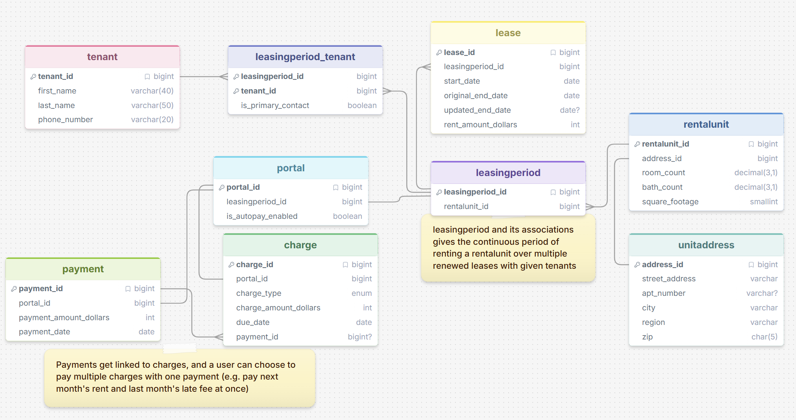

# Rental Management SQL Assistant

This project uses a language model to translate natural-language questions about a rental management database into SQLite queries.



## Query I thought it did well on

**Question:** What rental units have late charges, and what is the name and phone number of the tenant primary contact of that unit?

**SQL generated by `single_domain`:**

```sql
SELECT ua.street_address, ua.apt_number, ua.city, ua.region, ua.zip,
       t.first_name, t.last_name, t.phone_number
FROM charge c
INNER JOIN portal p ON c.portal_id = p.portal_id
INNER JOIN leasingperiod lp ON p.leasingperiod_id = lp.leasingperiod_id
INNER JOIN rentalunit ru ON lp.rentalunit_id = ru.rentalunit_id
INNER JOIN unitaddress ua ON ru.unitaddress_id = ua.unitaddress_id
INNER JOIN leasingperiod_tenant lpt ON lp.leasingperiod_id = lpt.leasingperiod_id
INNER JOIN tenant t ON lpt.tenant_id = t.tenant_id
WHERE c.payment_id IS NULL
  AND lpt.is_primary_contact = TRUE;
```

The query connected charges to rental units and their primary tenant contacts. It returned two units; one contact had no phone number in the data.

## Question that did not work well

**Question:** Which rental units have all current charges paid?

**SQL generated by `single_domain`:**

```sql
SELECT ru.rentalunit_id
FROM rentalunit ru
INNER JOIN leasingperiod lp ON ru.rentalunit_id = lp.rentalunit_id
INNER JOIN portal p ON lp.leasingperiod_id = p.leasingperiod_id
INNER JOIN charge c ON p.portal_id = c.portal_id
WHERE c.payment_id IS NOT NULL
GROUP BY ru.rentalunit_id
HAVING COUNT(c.charge_id) = COUNT(c.payment_id);
```

The query returned rental unit IDs 201, 202, and 203. However, the `WHERE` clause removes every unpaid charge before the groups are counted. The `HAVING` comparison therefore only checks the remaining paid charges, so the query can include a unit that has unpaid charges too. It also does not define or filter what makes a charge “current.”

## Takeaway

The model handled the multi-table lookup well, especially with the single-domain model, which had the highest accuracy in creating queries consistent with the schema. The paid-charges query sounded plausible while failing to test the full set of charges, which might be chalked up to missing wording in how payments and charges relate to one another.
